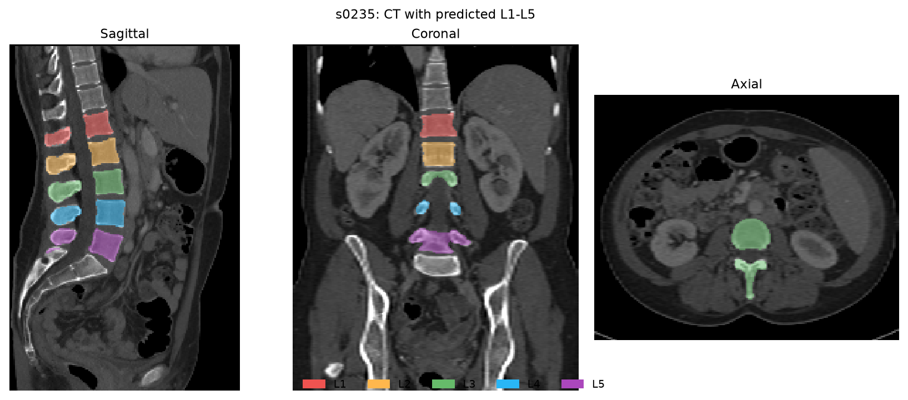

# Lumbar CT segmentation

**Status: ongoing.** This repository documents a working take-home submission and the results measured so far. The project segments lumbar vertebrae L1–L5 in CT scans and estimates each vertebral body's centre in RAS world coordinates (millimetres).

The model is **nnU-Net v2 ResEnc M**, trained from scratch on the official TotalSegmentator training split. It was selected using the 57 TotalSegmentator validation scans. Inference reads CT only; reference labels are used for evaluation.



*Example inference on case s0235. Colours mark predicted L1–L5 vertebrae; this image is a visual example, not an accuracy measurement.*

## Measured results

Dice measures overlap (1 is perfect). Scores below average cases where the reference level is present, including missed levels scored as zero; `n` is the number of such cases. Macro Dice gives the five levels equal weight. The frozen checkpoint was evaluated on all 89 official TotalSegmentator test scans and 73 VerSe 2020 test scans. VerSe labels 20–24 map to L1–L5; L6 is outside the target classes.

| Level | TotalSegmentator Dice | VerSe Dice |
| --- | ---: | ---: |
| L1 | 0.846 (n=64) | 0.775 (n=58) |
| L2 | 0.884 (n=59) | 0.754 (n=58) |
| L3 | 0.865 (n=59) | 0.699 (n=58) |
| L4 | 0.894 (n=60) | 0.602 (n=57) |
| L5 | 0.923 (n=57) | 0.597 (n=51) |
| **Macro Dice** | **0.882** | **0.685** |

All 162 scans completed inference. Nine reference-present source levels had zero overlap; none did on VerSe. False lumbar predictions occurred on 1/19 entirely negative source scans and 3/15 negative VerSe scans. The model performed worse on VerSe, especially at L4/L5; a reviewed case had a one-level numbering shift. Body centres were exported, but their anatomical accuracy was not measured against independent reference points. The planned larger 541-scan training run has not been performed. Further work would expand source-only training, check partial scans and numbering on validation, and independently validate body centres.

See the [two-page report](REPORT.pdf) for methods, per-level case counts, failures and limitations. The [release ZIP with trained weights](https://github.com/subodhkhanger/lumbar-ct-segmentation-submission/releases/download/v1.0.0/lumbar-ct-segmentation.zip) contains the runnable snapshot; [release files and checksums](https://github.com/subodhkhanger/lumbar-ct-segmentation-submission/releases/tag/v1.0.0) are listed separately. A Git clone and GitHub's automatic source archives contain source code only. Training data is excluded.

## Inference

Install Python 3.11. Put CT `.nii` or `.nii.gz` files directly in an input folder, then run from the extracted release ZIP:

```bash
./run_inference.sh /path/to/input_cts /path/to/empty_output
```

The first run installs its Python packages automatically. It uses CUDA when available, then tries MPS, then CPU. Each scan gets its own output folder with the vertebrae masks, body masks, and centroid coordinates.

For CTs from these releases that lack spatial units in their NIfTI headers, prefix the command with `LUMBAR_UNITS_POLICY=totalsegmentator-v201` or `LUMBAR_UNITS_POLICY=verse2020`.

## Train a new model

You need Python 3.11 and the complete TotalSegmentator v2.0.1 dataset, including `meta.csv` and the case folders. From this folder, run:

```bash
python3.11 -m venv .venv
.venv/bin/python -m pip install -r requirements-nnunet.txt
LUMBAR_PYTHON="$PWD/.venv/bin/python" ./run_training.sh --data-dir /path/to/totalsegmentator_v201 --device auto
```

`auto` selects CUDA if available, otherwise CPU. You can also request `--device cuda`, `mps`, or `cpu`. The new model is saved under `training/full_source/`; the supplied inference weights are left unchanged.
